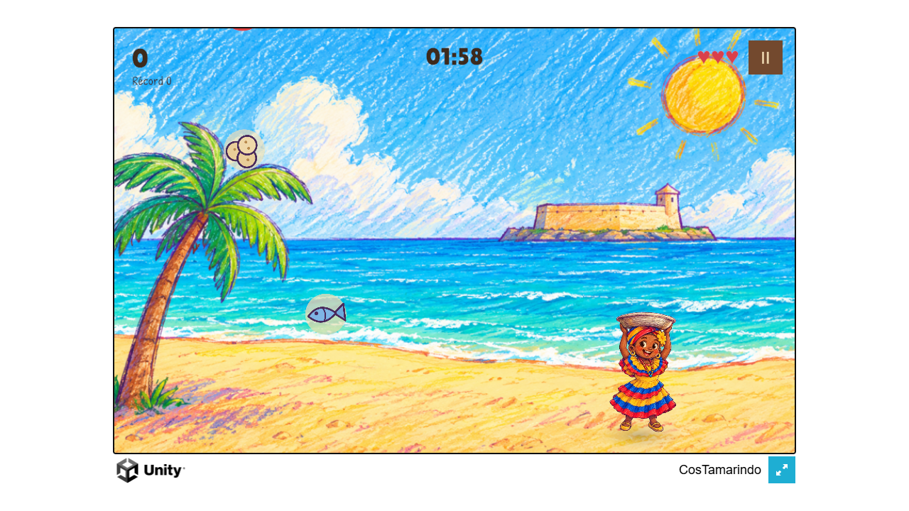

# F6 · Infraestructura Docker de 5 nodos — en curso

> **Estado:** 🚧 `Sg-Frontend` corriendo con HTTPS · faltan backend, IA y seguridad
> **Fecha:** 2026-10-28
> **Depende de:** [F3](F3.md) (build WebGL)
> **Siguiente:** backend y Supabase ([F4/F5 en `Plan.md`](../../Plan.md)) — es el requisito de `Sg-Backend`

---

## 1. Objetivo

Que todo el sistema se levante con **`docker compose up`** en una máquina limpia:
frontend, backend, IA y seguridad aislados por redes, con healthchecks y TLS local.
El nodo público (`Sg-Frontend`) ya está hecho y sirve el juego real.

---

## 2. Entorno instalado

| Componente | Versión / valor | Cómo se verificó |
| :--- | :--- | :--- |
| Docker Desktop | **4.97.0** | `winget install Docker.DockerDesktop` |
| Cliente / motor | **29.9.2 / 29.9.2** | `docker version` |
| Docker Compose | **v5.6.1** | `docker compose version` |
| Motor | WSL2, kernel `6.18.54.1-microsoft-standard-WSL2`, overlayfs | `docker info` |
| Recursos de la VM | 12 CPU · 15,6 GB RAM | `docker info` |
| mkcert | **1.4.4** | `mkcert -CAROOT` |
| Distro WSL | `docker-desktop` (V2, Running) | `wsl -l -v` |

Notas de instalación:

- Se instaló con **winget** y un solo UAC. El usuario quedó en el grupo `docker-users`,
  así que no hizo falta cerrar sesión.
- **AutoStart está desactivado**: tras reiniciar Windows hay que abrir Docker Desktop
  (Settings → General → *Start Docker Desktop when you sign in* para cambiarlo).
- El motor entrega **15,6 GB** de RAM a la VM; sobra para Nginx + backend + `qwen2.5:3b`
  y queda margen para Wazuh, pero conviene vigilarlo cuando estén los 5 nodos.

---

## 3. Lo que se hizo

| # | Paso | Resultado |
| :--- | :--- | :--- |
| 1 | Instalar Docker Desktop + motor WSL2 | `hello-world` OK |
| 2 | `infra/docker-compose.yml` con `Sg-Frontend` | servicio healthcheck, red `costamarindo-dmz` |
| 3 | `infra/scripts/tls.ps1` con mkcert | certificado `juego.local` + CA confiada por usuario |
| 4 | Publicar puertos `443` y `8081` | HTTPS del juego y HTTP plano |
| 5 | Montar el build en solo lectura | `../builds/webgl → /usr/share/nginx/html` |
| 6 | Verificar en navegador real | 2,9 s, 16,1 MB, 0 errores ([F3](F3.md) §3) |

Comandos:

```powershell
# 1. Compilar el juego (deja el build en builds/webgl)
powershell -File infra/scripts/build_webgl.ps1

# 2. Certificado local (una sola vez por máquina)
powershell -File infra/scripts/tls.ps1

# 3. Levantar el nodo público
docker compose -f infra/docker-compose.yml up -d --wait

# 4. Comprobar
docker compose -f infra/docker-compose.yml ps
curl --ssl-no-revoke https://juego.local/healthz
```

El paso manual que no se puede automatizar sin UAC es agregar la entrada a `hosts`:

```
127.0.0.1  juego.local
```

---

## 4. El compose actual

`infra/docker-compose.yml` declara **un solo servicio** y una sola red. Es deliberado:
`Sg-Backend` no puede existir hasta que haya `backend/` (F4/F5), y `Sg-AI` depende de
Ollama (F7).

| Elemento | Valor | Por qué |
| :--- | :--- | :--- |
| Imagen | `nginx:1.29-alpine` | ligera y con el `gzip` nativo que necesita el build |
| Puertos | `443:443`, `8081:8080` | el **8080 del host lo ocupa Unity MCP** |
| Build | `../builds/webgl`, **solo lectura** | el artefacto se reconstruye, no se copia |
| Config | `nginx.conf`, `conf.d/`, `snippets/` montados | se edita fuera del contenedor |
| TLS | `infra/tls/` → `/etc/nginx/certs` | `infra/tls/` está en `.gitignore` |
| Red | `costamarindo-dmz` | zona pública; el backend se conectará aquí y a `app` |
| Healthcheck | `wget -qO- http://127.0.0.1:8080/healthz` | el `restart` no gira sobre un Nginx roto |
| Logs | JSON de Nginx, `json-file` 10 MB × 3 | Wazuh los consumirá en F8 |

`/api/` ya está proxificado a `http://sg-backend:8000`. Mientras ese servicio no exista,
Nginx arranca igual y devuelve **502** (el nombre se resuelve con el DNS interno en cada
petición, no al arrancar).

---

## 5. TLS local

| Dato | Valor |
| :--- | :--- |
| Herramienta | mkcert 1.4.4 |
| Certificado | `infra/tls/juego.local.pem` (+ `-key.pem`) |
| Nombres | `juego.local`, `localhost`, `127.0.0.1`, `::1` |
| Caducidad | **2029-01-28** |
| CA | `mkcert` la crea en `%LOCALAPPDATA%\mkcert` y se confía **en el almacén del usuario** |

Confiar la CA por usuario evita el UAC: Edge y Chrome leen ese almacén. Si se regenera el
certificado, hay que recargar Nginx (`docker exec sg-frontend nginx -s reload`).

> `curl.exe` de Windows usa Schannel y contra esta CA falla con
> `CRYPT_E_NO_REVOCATION_CHECK` (no puede consultar revocación). No es un fallo del
> certificado: se usa `--ssl-no-revoke`. Los navegadores no fallan.

---

## 6. Verificación

| Comprobación | Resultado |
| :--- | :--- |
| `docker compose ps` | `sg-frontend` **healthy** |
| `https://juego.local/healthz` | `ok` |
| Carga del juego (Edge headless) | **2,9 s**, 16,1 MB, 0 errores, 0 advertencias |
| Respuestas HTTP ≥ 400 | **0** |
| Cabeceras | CSP por hash, HSTS 1 año, `X-Frame-Options: DENY`, `nosniff` |
| Wasm | `application/wasm` + `Content-Encoding: gzip` + `immutable` |
| Puerto 8000/11434 desde el host | no publicados (los publicará cada nodo cuando exista) |

Evidencia: [`evidencias/F3/check-nginx.json`](../../evidencias/F3/check-nginx.json) y las
capturas `screenshot-nginx*.png`. La fase F3 la usa como cierre de su DoD.



*El build WebGL de 16,1 MB servido por `Sg-Frontend` por HTTPS, con el HUD, el fondo, la
Palenquera y los ítems en movimiento.*

---

## 7. Trampas (no repetirlas)

1. **El 8080 del host es de Unity MCP.** `mcp-for-unity` escucha ahí; Docker no puede
   publicar ese puerto. Por eso el HTTP plano va al 8081 y el contenedor sigue usando 8080
   por dentro.
2. **`hosts` en solo lectura.** El antivirus le pone el atributo `ReadOnly`; `Add-Content`
   falla con «Acceso denegado» incluso en consola elevada. Hay que quitarlo, escribir y
   restaurarlo.
3. **`docker` no aparece en el PATH del proceso del agente** aunque sí esté en el de
   máquina: hay que abrir una terminal nueva o usar
   `C:\Program Files\Docker\Docker\resources\bin\docker.exe`.
4. **La CSP se lee al arrancar.** El build se monta en vivo, pero `csp.conf` se genera
   después del build; sin `nginx -s reload` el hash viejo bloquea el script inline de Unity
   y el juego se queda cargando.
5. **`docker-credential-desktop` debe estar en el PATH.** Si no, cualquier `pull` falla con
   `error getting credentials` aunque el motor esté sano.

---

## 8. Pendiente para cerrar F6

| # | Pendiente | Depende de |
| :--- | :--- | :--- |
| 1 | `Sg-Backend` (Dockerfile multi-stage, usuario no root, `expose` 8000) | F5 |
| 2 | `Sg-AI` (Ollama, volumen de modelos, bind solo a red `ai`) | F7 |
| 3 | `Sg-Security` (perfil `security`: Wazuh y SonarQube) | F8 |
| 4 | Redes `app`, `data`, `ai`, `mgmt` y `mem_limit` por servicio | F5 |
| 5 | `docker-compose.override.yml` para dev (`8081`) y prod (solo `443`) | F5 |
| 6 | Scripts `up.sh`, `down.sh`, `logs.sh`, `deploy.sh` | F5 |
| 7 | Verificar aislamiento con `nmap` desde host y desde otro contenedor | F8 |
| 8 | `.env` real con claves de Supabase | F4 |

---

## 9. Operación diaria

```powershell
# estado
docker compose -f infra/docker-compose.yml ps

# logs
docker logs -f sg-frontend

# apagar / encender
docker compose -f infra/docker-compose.yml down
docker compose -f infra/docker-compose.yml up -d --wait

# tras recompilar el juego
docker exec sg-frontend nginx -s reload

# validar la configuración de Nginx sin reiniciar
docker exec sg-frontend nginx -t
```

---

## 10. Artefactos

| Ruta | Qué es | ¿En git? |
| :--- | :--- | :--- |
| `infra/docker-compose.yml` | nodo `Sg-Frontend` | sí |
| `infra/nginx/**` | configuración del servidor | sí |
| `infra/scripts/tls.ps1` | certificado local con mkcert | sí |
| `infra/tls/` | certificado y clave | **no** (`.gitignore`) |
| `builds/webgl/` | build servido (artefacto) | **no** (`[Bb]uilds/`) |
| `evidencias/F3/` | medición y capturas | sí |
