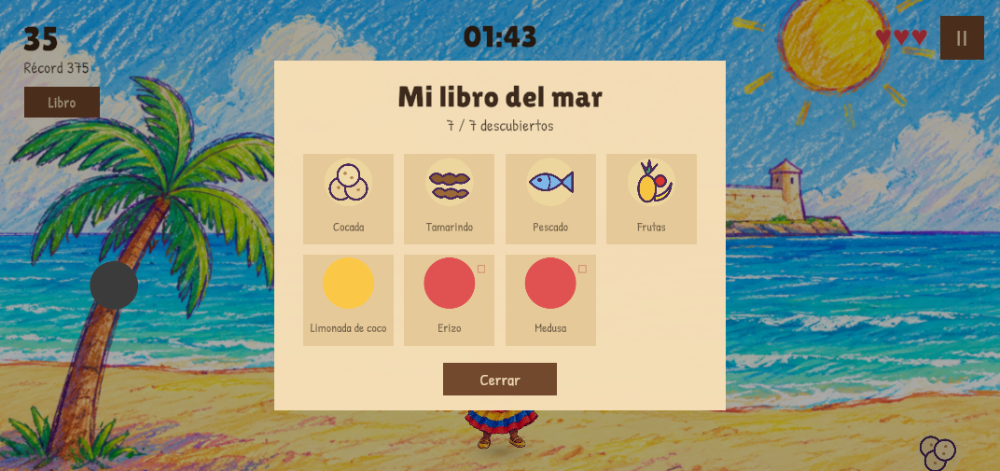

# F2 · Pantalla Libro y feedback de captura — evidencia

> **Fase:** F2 · vertical slice jugable
> **Fecha:** 2026-11-03
> **Estado:** ✅ los dos pendientes de UI de F2 quedaron implementados y probados
> **Tests:** 15/15 PlayMode en verde (eran 6)

---

## 1. Qué se cerró

`docs/fases/F2.md` §7 listaba dos pendientes que no dependían de Figma ni de Supabase:

1. **Pantalla «Libro»** con la grilla de coleccionables.
2. **Feedback de captura** (destello, texto flotante y sonido).

Ambos están terminados. El modelo de datos ya existía: `CollectionBook` persistía en
`PlayerPrefs` y `GameManager` desbloqueaba en cada captura. Faltaba solo la capa visual.

---

## 2. Pantalla Libro

| Pieza | Archivo |
| :--- | :--- |
| Vista | `unity/Assets/Scripts/UI/BookView.cs` |
| Modelo (ya existía) | `unity/Assets/Scripts/Core/CollectionBook.cs` |
| Catálogo | `ItemCatalog.Collectibles` (7 ítems; la basura no colecciona) |

Comportamiento:

- Se abre con el botón **Libro** del HUD o con la tecla **L**; se cierra con **Esc**, con el
  botón **Cerrar** o con **L** otra vez.
- La grilla se construye **en runtime** y se repuebla al abrir: un ítem capturado durante la
  partida aparece desbloqueado sin recargar la escena.
- Los ítems bloqueados muestran `???` y una silueta oscura; los desbloqueados, su nombre y su
  sprite.
- Los ítems sin arte todavía (limonada, erizo, medusa) usan el mismo relleno procedural que el
  gameplay, así que no se ven como huecos.



*Grilla 4×2 con los cuatro ítems que ya tienen arte y los tres que usan relleno procedural.*

### Dos defectos de layout que se encontraron y corrigieron

La primera versión tenía la altura de la tarjeta en `gridHeight + 240` y la última fila quedaba
**debajo del botón «Cerrar»**. Además, «Limonada de coco» no cabía en una línea y se recortaba.

| Defecto | Corrección |
| :--- | :--- |
| Última fila tapada por «Cerrar» | Altura de tarjeta a `gridHeight + 330` |
| Nombres de dos líneas recortados | Fuente 30→26, alto de etiqueta 46→64 px |
| Retrato pisaba el nombre | Retrato subido a `0.19·cellSize.y`, alto `0.58·cellSize.y` |

Se verificó con captura en Play, no leyendo el código.

---

## 3. Feedback de captura

| Pieza | Archivo |
| :--- | :--- |
| Presentación | `unity/Assets/Scripts/UI/CaptureFeedback.cs` |
| Audio | `unity/Assets/Scripts/Audio/ProceduralSfx.cs` |

Qué se ve y se oye al atrapar:

| Caso | Texto flotante | Color | Sonido |
| :--- | :--- | :--- | :--- |
| Ítem bueno | `+15` | verde | blip ascendente |
| Ítem bueno nuevo | `+15` + «¡Nuevo!» | verde + ámbar | arpegio |
| Peligro (erizo, medusa) | `-1 ♥` | rojo | zumbido grave |
| Basura | `-10` | rojo | zumbido grave |

Además el marcador hace un pulso de escala de 0.18 s en cada captura.

### El audio se sintetiza, no se importa

`ProceduralSfx` genera los tres clips **en memoria** con un barrido de frecuencia y una
envolvente de ataque/decaimiento. Razón: los SFX de Figma no están exportados (F1 bloqueada) y
el juego no debía quedarse sin audio por eso. Pesa **cero bytes** en el build y no añade
dependencias. Cuando llegue el arte real, se reemplazan tres propiedades.

### Un detalle de orden de capas

Las etiquetas flotantes viven en `FloatingLayer`, en el índice 1 del canvas: por encima del HUD
y **por debajo** de los paneles modales (pausa, game over, libro). Se comprobó el orden real de
los hijos del canvas, no se asumió.

---

## 4. Pruebas añadidas

`unity/Assets/Tests/PlayMode/AuthAndBookPlayModeTests.cs` — 9 pruebas nuevas, 15/15 en total.

| Prueba | Verifica |
| :--- | :--- |
| `RejectsUsernameTooShort` | Usuario de 2 caracteres rechazado |
| `RejectsUsernameWithInvalidCharacters` | Espacios y símbolos rechazados |
| `RejectsPinThatIsNotFourDigits` | PIN no numérico o de otra longitud rechazado |
| `FirstLoginCreatesAccountAndReturnsTokenInMemory` | Token solo en memoria, **nunca** en `PlayerPrefs` |
| `WrongPinForExistingAccountFails` | PIN incorrecto sobre cuenta existente |
| `FiveFailures_LockTheAccount` | 5 fallos → bloqueo; ni el PIN correcto entra |
| `SuccessfulLoginResetsFailureCounter` | Un acierto limpia el contador |
| `Book_OpensAndCloses` | El Libro abre y cierra en la escena real |
| `CatchingCollectible_UnlocksItInTheBook` | Capturar desbloquea; la basura no entra |

```
PlayMode: total=15  passed=15  failed=0  skipped=0
```

---

## 5. Otros artefactos de esta sesión

| Archivo | Qué es |
| :--- | :--- |
| `unity/Assets/Scripts/UI/LoginController.cs` | Controlador de la pantalla de acceso |
| `unity/Assets/Scripts/Auth/AuthStub.cs` | Autenticación local (stub de F4), con A.8.5 aplicado |
| `unity/Assets/Editor/CosTamarindoLoginSceneBuilder.cs` | Genera `Assets/Scenes/Login.unity` |
| `unity/Assets/Scenes/Login.unity` | Escena de acceso (build index 1) |

---

## 6. Pendiente de F2

- [ ] Playtest real de 10–15 min para ajustar `spawnInterval` y `fallSpeed`.
- [ ] Sustituir el relleno procedural de 4 ítems cuando llegue el token de Figma (F1).
- [ ] Hacer obligatorio el acceso: mover `Login` a build index 0 cuando F4/F5 estén listos.
